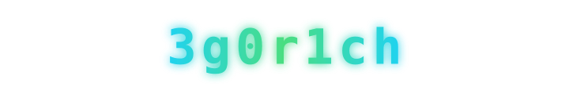
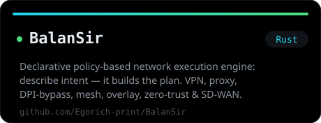
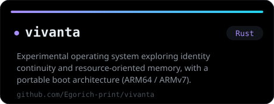
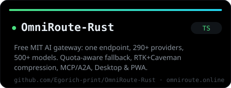
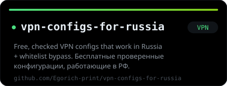
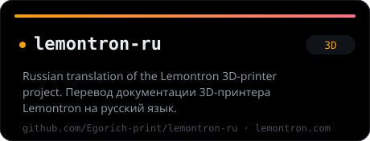

  

  

 

  
  
  
  
  
  

---

## 👋 About / О себе

<b>EN:</b> I'm <b>3g0r1ch</b> (Egorich) — an engineer who likes going deep: from packet-level networking and policy engines to AI gateways and operating systems. Most of my work lives in Rust and TypeScript, and part of it happens in the homelab.

<b>RU:</b> Привет! Я <b>3g0r1ch</b> (Egorich). Инженер, которому нравится копаться вглубь: от пакетного уровня сетей и policy-движков до AI-шлюзов и операционных систем. Большая часть работы — на Rust и TypeScript, часть — в собственном homelab.

---

## 🛠️ Projects / Проекты

<table align="center">
  <tr>
    <td></td>
    <td></td>
  </tr>
  <tr>
    <td></td>
    <td></td>
  </tr>
  <tr>
    <td align="center"></td>
  </tr>
</table>

---

## 📊 Live stats / В цифрах

  
  
  

---

## 🗂️ What I'm into / Чем занимаюсь

  
  
  
  
  

---

## 🇷🇺 Обо мне (Русский)

Привет! Я <b>3g0r1ch</b>. Мне интересны глубокие темы: собственный движок сетевой политики <b>BalanSir</b> (Rust), экспериментальная ОС <b>vivanta</b> для ARM, AI-шлюз <b>OmniRoute</b>, VPN-конфиги для РФ и перевод документации <b>Lemontron</b>. Код — преимущественно на Rust и TypeScript. Часть инфраструктуры живёт в собственном homelab.

Всегда открыт к идеям и коллаборациям. Если проект зацепил — загляните в issues или напишите.

---

  

    
    
  

  
<a href="https://github.com/Egorich-print">github.com/Egorich-print</a>

